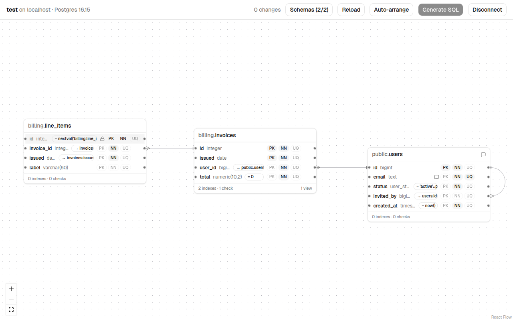
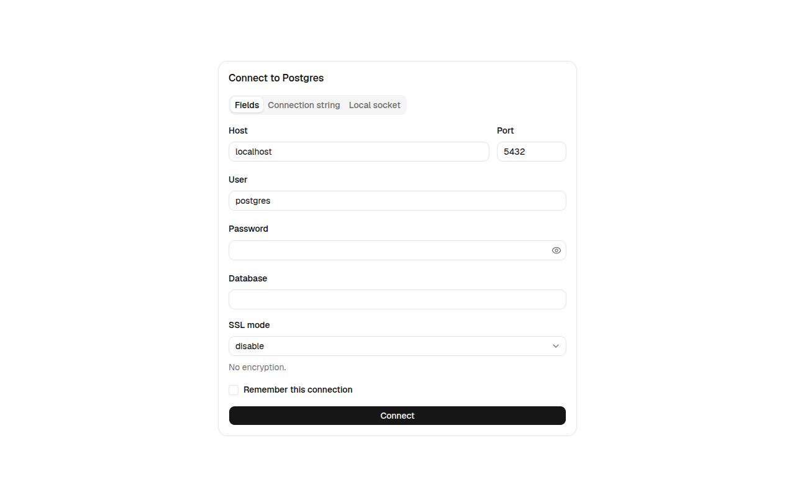
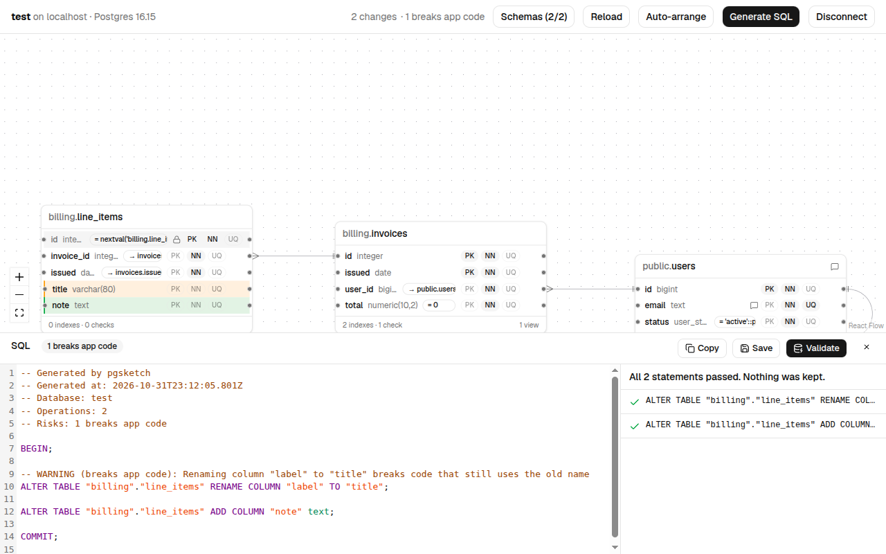

# pgsketch

pgsketch is a Linux desktop app for changing a Postgres schema on a diagram. You connect to a database, edit its tables on a canvas, and pgsketch writes the migration SQL for what you changed. **It never applies anything to your database**: you copy or save the SQL and run it yourself.



## Install

pgsketch is packaged as a `.deb` for Debian-based systems. The package is tested on Ubuntu 24.04 and Debian 12. It needs a desktop session; there is no command-line interface.

1. Download `pgsketch_<version>_amd64.deb` from the [releases page](https://github.com/PratikDev/pgsketch/releases).
2. Install it from the folder you downloaded it to. Installing from your home folder works, and apt only notes that it downloaded the file as root.

```bash
sudo apt install ./pgsketch_0.1.0_amd64.deb
```

3. Open **pgsketch** from the applications menu, or run `pgsketch` in a terminal. If the menu shows a gear instead of the logo, your desktop is using an old icon cache: restart it (on Cinnamon, `Ctrl+Alt+Esc`) or log out and back in.

To remove it, run `sudo apt remove pgsketch`. Your saved connections and drafts stay in `~/.local/share/pgsketch/`; delete that folder to remove them too.

Postgres 14 and newer are supported.

## Using it

The loop is: connect, edit on the canvas, generate the SQL, optionally validate it, then copy or save it.

### Connect



Connect with host, port, user and password, with a connection string, or through the local Unix socket (which uses your OS user). The SSL mode follows libpq's meanings: `disable`, `prefer`, `require` and `verify-full`. It starts at `disable` for local hosts and `require` for remote ones.

Tick **Remember this connection** to save it. The password is encrypted with your system keyring, is kept by the main process only, and never reaches the interface. Without a keyring the connection is saved without its password, and pgsketch says so.

### Edit

Every schema that is not a system schema is drawn as a table node, with its foreign keys as lines between them. Use **Schemas** to show only some, and **Auto-arrange** to lay the tables out again; positions are otherwise kept for each database.

You edit in place: click a column name or type to change it, use the badges for primary key, not null and unique, drag from one column to another to make a foreign key, and use a table's toolbar to add columns, indexes and checks, to comment on it, or to delete it. Double-click the empty canvas for a new table; its schema picker can make a new schema. Changes show on the diagram as you make them:

- **added** in green
- **modified** in amber
- **removed** in red with a strikethrough, still visible and restorable until you reload

The top bar counts the changes and the risky ones among them. Your unsaved edits are kept if you close the app and open the same database again.

### Generate, validate, deliver



**Generate SQL** opens a panel with the migration: plain, up-only SQL inside `BEGIN; … COMMIT;`, with a `-- WARNING` comment above every risky statement (destructive, breaks app code, and so on) and a summary at the top.

**Validate** runs the migration on a connection of its own inside `BEGIN … ROLLBACK`, one statement at a time, and shows which statements passed and where it stopped. Nothing is kept. If the host is not your own machine, it asks first.

**Copy** puts the SQL on the clipboard. **Save** opens the save dialog, in the folder you last saved to, with a name like `20261101_120000_pgsketch.sql`.

### When the database changes underneath you

pgsketch checks the database every few seconds and when the window gets focus. If the change is exactly what your edits describe (you ran the SQL), it adopts it and shows "changes applied". If it is something else, SQL generation is blocked until you reload, which discards your edits after a confirmation.

### What it does not do yet

0.1.0 does not apply migrations, write down migrations, undo, create or edit enums, rename or drop existing schemas, move tables between schemas, or handle views, functions, triggers and the like. An object with something pgsketch does not model (a partial index, a generated column, a `serial` default) is shown and kept as it is, read-only. The full list is in the [build plan](<docs/pgsketch — Build Plan (0.1.0).md>).

### Files

| What                               | Where                                 |
| ---------------------------------- | ------------------------------------- |
| Program                            | `/opt/pgsketch/`                      |
| Saved connections, drafts, layouts | `~/.local/share/pgsketch/pgsketch.db` |
| Log                                | `~/.local/state/pgsketch/main.log`    |

## Architecture

A pnpm workspace with two packages.

- **`packages/core`** is plain TypeScript with no Electron, React or `pg` in it. It holds the schema model, introspection, the diff between the loaded and the edited schema, risk assessment, ordering and SQL rendering. Its tests include ones that run against real Postgres 14 to 18 in Docker.
- **`apps/desktop`** is the Electron app, built with electron-vite.
  - `src/main` is the main process. It is the only part that talks to Postgres or the disk: connections, the SQLite file, the keyring, the validator, and the file dialog.
  - `src/preload` exposes a typed API to the renderer.
  - `src/renderer` is the React editor: the canvas, the editors, the SQL panel and the stores. It uses `packages/core` to recompute the diff on every edit.

The renderer and the main process talk only through typed IPC channels, and the main process validates every input with zod. The design, with every decision behind it, is in the [build plan](<docs/pgsketch — Build Plan (0.1.0).md>); decisions made while building are in [`docs/DECISIONS.md`](docs/DECISIONS.md).

## Development

You need Node 24, pnpm, and Docker for the database tests.

```bash
pnpm install
pnpm --filter @pgsketch/desktop dev
```

| Command                                    | What it does                                                                           |
| ------------------------------------------ | -------------------------------------------------------------------------------------- |
| `pnpm lint`                                | ESLint and a Prettier check                                                            |
| `pnpm typecheck`                           | Type checks every package                                                              |
| `pnpm test`                                | Unit and component tests (no Docker)                                                   |
| `pnpm --filter @pgsketch/core test:db`     | Postgres tests in Docker; set `PG_VERSION` to 14-18                                    |
| `pnpm --filter @pgsketch/desktop test:e2e` | Builds the app and runs the Playwright tests; needs a display (`xvfb-run` on a server) |
| `pnpm --filter @pgsketch/desktop package`  | Builds `apps/desktop/dist/pgsketch_<version>_amd64.deb`                                |
| `bash apps/desktop/scripts/check-deb.sh`   | Installs that `.deb` on clean Ubuntu and Debian images in Docker and starts it         |

The pictures in this file come from `PGSKETCH_SCREENSHOTS=1 pnpm --filter @pgsketch/desktop test:e2e e2e/screenshots.spec.ts`. The icon in `apps/desktop/build/icon.png` is the source for the sizes in `build/icons/`; run `apps/desktop/scripts/make-icons.sh` after changing it.
