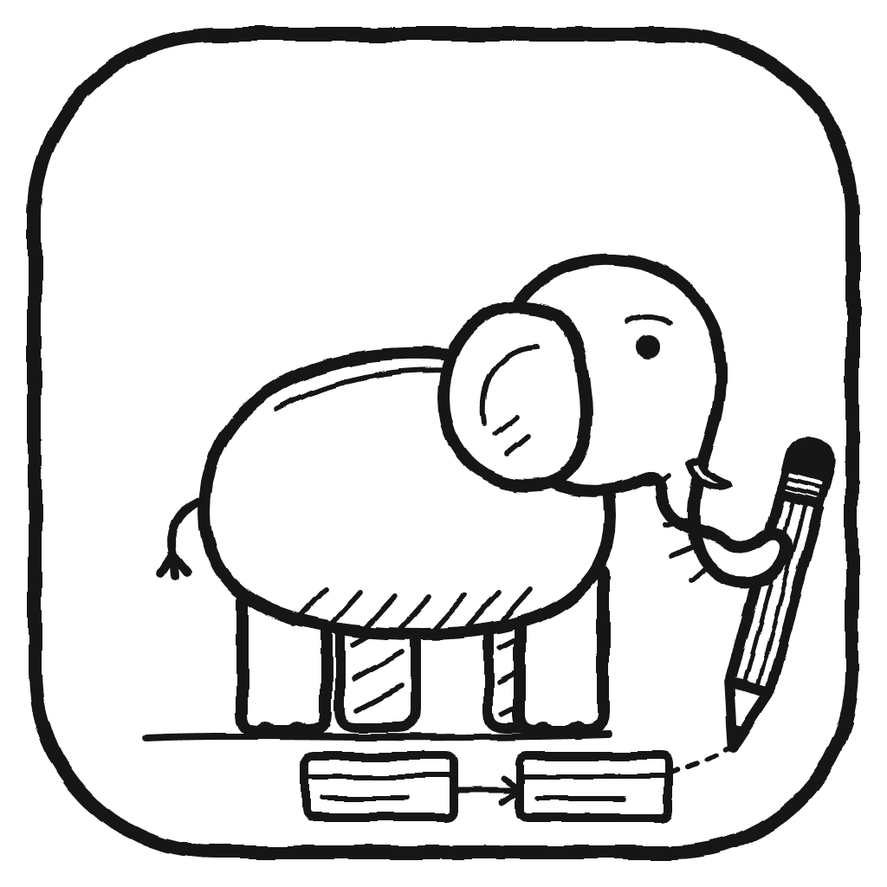
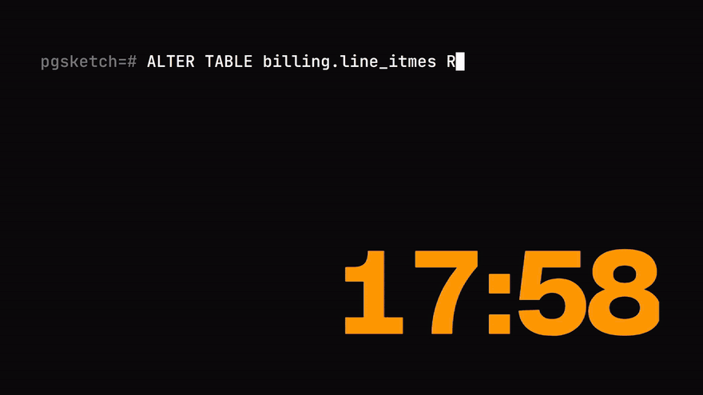
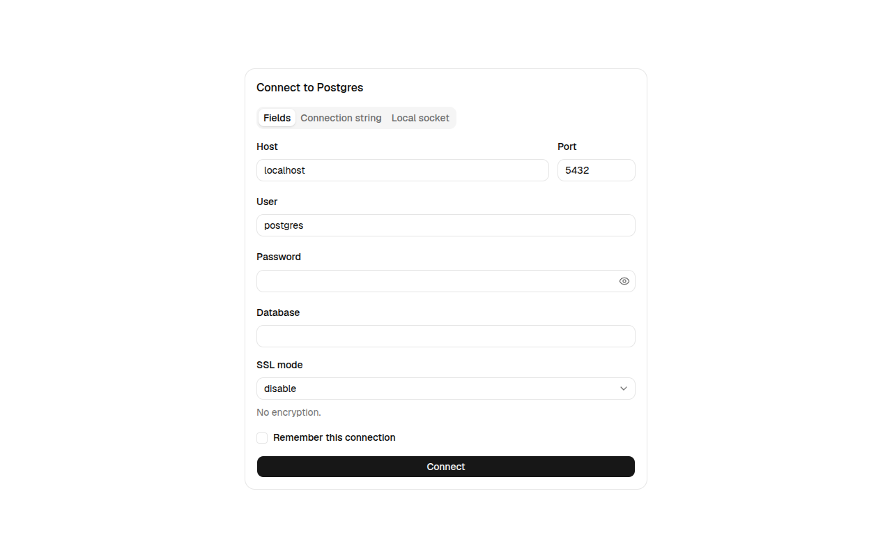
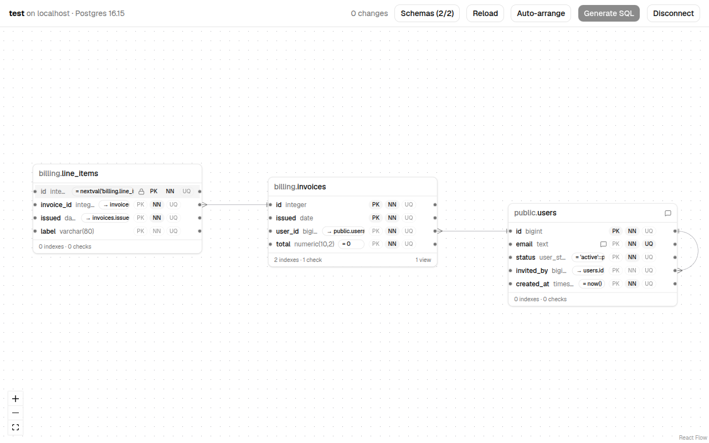
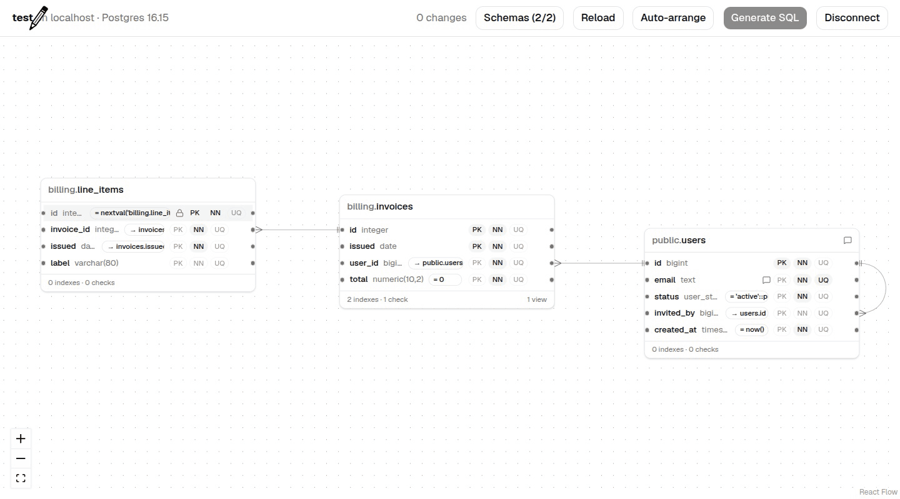
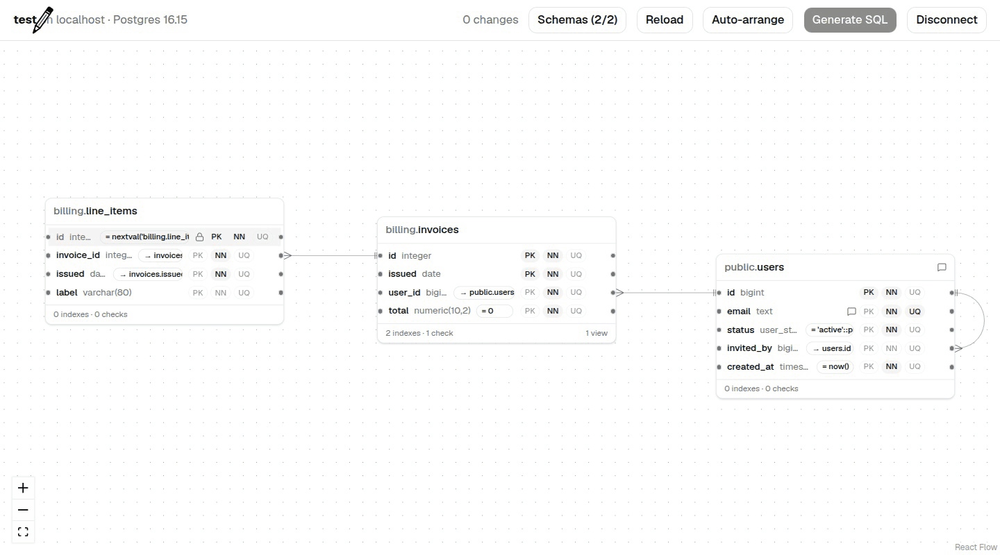
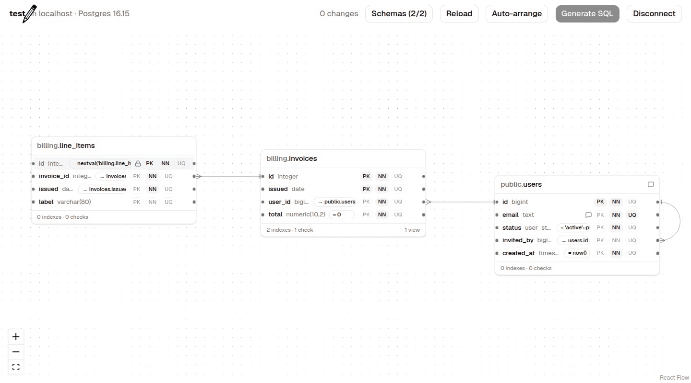
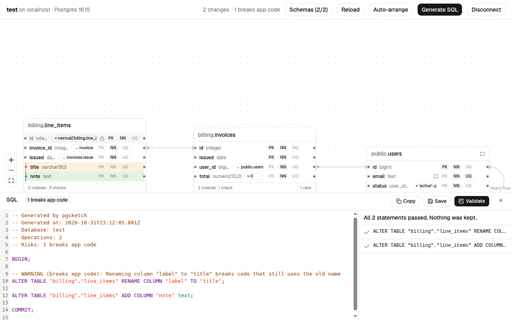
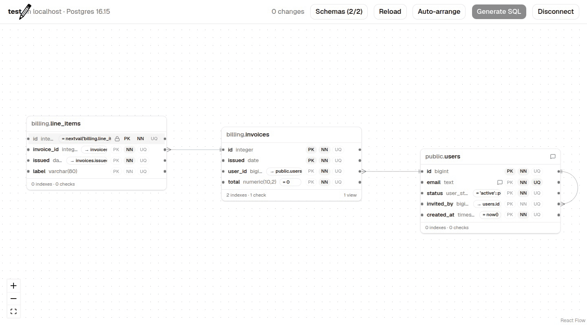
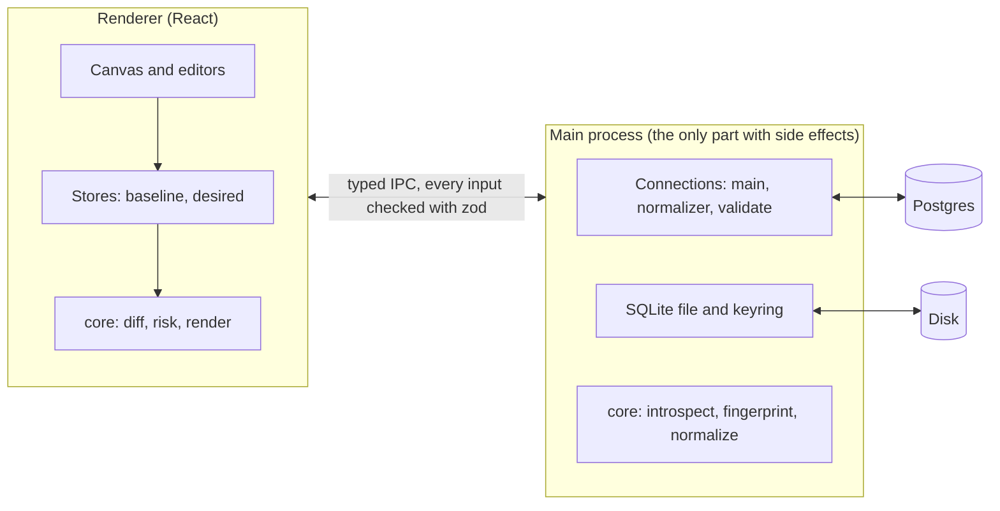

# pgsketch
<!--  -->

[](apps/desktop/build/icons/256x256.png)

pgsketch is a Linux desktop app for changing a Postgres schema on a diagram. You connect to a database, edit its tables on a canvas, and pgsketch writes the migration SQL for what you changed. **It never applies anything to your database.** You read the SQL, check it with a dry run if you like, and run it yourself.

[](docs/media/pgsketch-friday.mp4)

<sub>The first 22 seconds of [a 30-second film](docs/media/pgsketch-friday.mp4) made from recordings of the app. The two errors in the terminal are what Postgres 16 really answered.</sub>

## Why it exists

A column rename is one line of SQL, and it still goes wrong: a typo in the table name, a typo in the column name, a second try with the first one half-remembered. Bigger changes (a type change that needs a `USING`, a foreign key that has to come off before a column can go) are easy to order wrongly and easy to get silently wrong.

pgsketch takes the diagram as the place to say what you want and does the bookkeeping: it knows what the database looks like now, diffs it against what you drew, orders the statements so every dependency exists when it runs, and puts a warning above each statement that can lose data, fail on real rows, or break the code that calls the old name. The output is plain SQL. There is no project file, no migration history table, and no tool that has to stay installed: the database is the source of truth, and the SQL is yours.

## A tour

### Connect



Connect with host, port, user and password, with a connection string, or through the local Unix socket (which uses your OS user). The SSL mode follows libpq's meanings: `disable`, `prefer`, `require` and `verify-full`. It starts at `disable` for local hosts and `require` for remote ones, and a pasted connection string's `sslmode` only fills the selector, which is the one place the mode is decided.

Tick **Remember this connection** to save it. The password is encrypted with your system keyring and kept by the main process alone: the interface asks to open a saved connection by its ID and never holds the password. Without a keyring the connection is saved without its password, and pgsketch says so.

### See the schema



Every schema that is not a system schema is drawn as a table node, with its foreign keys as lines between them (crow's feet for the many side, a loop for a table that points at itself). Pick which schemas to show with **Schemas**, and lay the tables out again with **Auto-arrange**; otherwise positions stay where you put them, per database, and come back next time.

Below 70% zoom, tables shrink to a name and a column count and panning stays smooth; click one to zoom to it. Zoomed in on a very large schema the canvas is slow: a pan across 100 tables cost several seconds a move on the machine it was measured on, so for hundreds of tables show a few schemas at a time. Making that fast is the next performance task. Things pgsketch does not model (a partial index, a generated column, a `serial` default) are shown with a lock and left exactly as they are.

### Edit in place



There is no side panel. You click what you want to change.

| To change                     | Do this                                                                                                                               |
| ----------------------------- | ------------------------------------------------------------------------------------------------------------------------------------- |
| A table or column name        | Click it, type, Enter or Tab. Esc cancels.                                                                                            |
| A type                        | Click it for a searchable picker of the built-in types and the enums that exist, with parameters (`varchar(80)`) and an array switch. |
| Primary key, NOT NULL, unique | Click the badge. NOT NULL is locked on while the column is a primary key, and on identity columns.                                    |
| A default                     | Click the chip: presets for the type, a constant, or an expression the database checks as you type.                                   |
| A comment                     | The row menu or the table toolbar.                                                                                                    |
| A new column                  | The toolbar above a table, or Enter on the last row.                                                                                  |
| An index or a check           | The table footer: columns in order and unique for an index, an expression for a check.                                                |
| A new table                   | Double-click the empty canvas. It starts with a `bigint` identity primary key. Its schema can be a new one.                           |

Tab walks name → type → next row. Changes show on the diagram as you make them:

- **added** in green
- **modified** in amber, with the old value on hover
- **removed** in red with a strikethrough, still visible and restorable until you reload

The top bar counts the changes and the risky ones among them. Unsaved edits survive closing the app.

### Draw a relationship



Drag from one column to another, in any table, including the same one. pgsketch refuses a foreign key between types that cannot be compared and tells you why. Click the line for `ON DELETE`, `ON UPDATE` and removal.

### Remove, and take it back



Deleting a column takes with it everything that depends on it: the constraints and indexes on its table that include it, and the foreign keys on other tables that point at it. They are all shown as removed, and all come back together when you restore the column. Deleting a table does the same, and its incoming foreign keys show as removed straight away. If something pgsketch cannot rewrite depends on what you are removing (a view, a policy, a foreign key it treats as read-only), the removal is refused and the reason is named.

### Generate, validate, deliver



**Generate SQL** opens a panel with the migration. This is the real output for the rename and the new column in the picture above:

```sql
-- Generated by pgsketch
-- Generated at: 2026-10-31T23:12:05.801Z
-- Database: test
-- Operations: 2
-- Risks: 1 breaks app code

BEGIN;

-- WARNING (breaks app code): Renaming column "label" to "title" breaks code that still uses the old name
ALTER TABLE "billing"."line_items" RENAME COLUMN "label" TO "title";

ALTER TABLE "billing"."line_items" ADD COLUMN "note" text;

COMMIT;
```

It is up-only SQL inside `BEGIN; … COMMIT;`. Every object is schema-qualified and every name quoted. The same changes always produce byte-identical text, so a migration you generate twice diffs clean. Statements are ordered in fixed phases (schemas, foreign keys and constraints that come off, columns and tables that are dropped, renames, new tables, new columns, type and default changes, new constraints and indexes, foreign keys last, comments), and drops come before renames and creations so a name is free by the time something else takes it.

A `-- WARNING` line goes above each statement that is risky, in one of these ways:

| Level           | What it covers                                                                                                                                                                  |
| --------------- | ------------------------------------------------------------------------------------------------------------------------------------------------------------------------------- |
| Destructive     | Dropping a table or column, a type change that loses data, and read-only objects that go with a dropped table or column (listed by name)                                        |
| May fail        | NOT NULL on existing rows, a NOT NULL column with no default added to a table, new unique, check or foreign key constraints, primary key changes, type changes that need a cast |
| Breaks app code | Renaming a table or column                                                                                                                                                      |
| Locks or slow   | Type changes that rewrite a table, constraint checks that scan one, an index build (it blocks writes, and `CONCURRENTLY` cannot run in a transaction)                           |

A type change gets a `USING` only when Postgres has no assignment conversion between the two types, decided from the server's own `pg_cast` and its rules for the rest. Adding it always would make some changes silently truncate where Postgres would otherwise raise an error. Anything unknown is treated as "may fail", never as safe.

**Validate** runs the migration inside `BEGIN … ROLLBACK` on a connection of its own, one statement at a time, with a 3 s lock timeout and a 30 s statement timeout, and shows which statements passed and where it stopped. Nothing is kept. The connection uses your original `search_path`, so it predicts your own run. If the host is not your own machine, it asks first, because a dry run still takes locks.

**Copy** puts the SQL on the clipboard. **Save** opens the save dialog in the folder you last saved to, with a name like `20261101_120000_pgsketch.sql`.

### When the database changes underneath you



pgsketch fingerprints the catalogs every five seconds and when the window gets focus. If a change is exactly what your edits describe (you ran the SQL), it adopts the new schema, keeps your layout, and shows "Changes applied". If it is something else, it blocks Generate SQL and Validate with a banner until you reload, which asks before it discards your edits. A restart after running the SQL while the app was closed is told the same way. Generate SQL and Validate check the fingerprint themselves first, so a stale view can never produce a migration.

## What it handles, and what it leaves alone

| Edited on the canvas                                                             | Not yet                                                                                     |
| -------------------------------------------------------------------------------- | ------------------------------------------------------------------------------------------- |
| Tables, columns, types, defaults, NOT NULL, identity on new columns              | Enums (existing ones are usable as types; creating or editing them waits)                   |
| Primary, unique, check and foreign key constraints, with `ON DELETE`/`ON UPDATE` | Moving a table to another schema, renaming or dropping an existing schema                   |
| Plain B-tree indexes, single and composite, unique or not                        | Turning identity on or off for an existing column                                           |
| Comments on tables and columns                                                   | Views, functions, triggers, partitions, policies, domains and sequences as editable objects |
| New tables and new schemas                                                       | Down migrations, undo and redo, table search                                                |

Anything with an attribute pgsketch does not model is read-only: shown, kept, and never dropped and re-created, so it cannot lose a detail on the way. That covers partial and expression indexes, `DESC`/`INCLUDE`/opclass indexes, deferrable and `NOT VALID` constraints, exclusion constraints, generated columns, `serial` defaults and partitioned tables. It is dropped only as a visible, named consequence of deleting its own table or column.

New constraints and indexes are named the way Postgres names them (`t_pkey`, `t_a_b_key`, `t_a_b_fkey`, `t_a_check`, `t_a_b_idx`, shortened to 63 bytes, with a number on a collision). Names of objects that already exist never change.

Postgres 14 to 18 are supported and tested.

## Install

pgsketch is packaged as a `.deb` for Debian-based systems, tested on Ubuntu 24.04 and Debian 12. It needs a desktop session; there is no command-line interface.

1. Download `pgsketch_<version>_amd64.deb` from the [releases page](https://github.com/PratikDev/pgsketch/releases).
2. Install it from the folder you downloaded it to. Installing from your home folder works, and apt only notes that it downloaded the file as root.

```bash
sudo apt install ./pgsketch_0.1.0_amd64.deb
```

3. Open **pgsketch** from the applications menu, or run `pgsketch` in a terminal. If the menu shows a gear instead of the icon, your desktop is using an old icon cache: restart it (on Cinnamon, `Ctrl+Alt+Esc`) or log out and back in.

To remove it, run `sudo apt remove pgsketch`. Your saved connections and drafts stay in `~/.local/share/pgsketch/`; delete that folder to remove them too.

| What                               | Where                                 |
| ---------------------------------- | ------------------------------------- |
| Program                            | `/opt/pgsketch/`                      |
| Saved connections, drafts, layouts | `~/.local/share/pgsketch/pgsketch.db` |
| Log                                | `~/.local/state/pgsketch/main.log`    |

## How it works



A pnpm workspace with two packages.

- **`packages/core`** is plain TypeScript with no Electron, React or `pg` in it: the schema model, introspection, the fingerprint, the diff, risk assessment, ordering and SQL rendering. The renderer runs it on every edit to recompute the diff; the main process runs the same code to read the database.
- **`apps/desktop`** is the Electron app, built with electron-vite. `src/main` talks to Postgres and the disk (connections, the SQLite file, the keyring, the validator, the file dialog), `src/preload` exposes a typed API, and `src/renderer` is the React editor (canvas, editors, SQL panel, stores).

One edit goes like this: a store action changes `desired`; a selector runs `diff(baseline, desired)` and the risk assessment; the canvas redraws the touched nodes and the top bar updates its counts; a second of idle time later the draft is saved. Objects carry stable IDs (from Postgres OIDs), so a rename is a rename and not a drop and an add.

Defaults and checks are compared in Postgres's own normal form, because `'active'` comes back as `'active'::text` and comparing raw text would invent changes. pgsketch asks the connected database for the canonical form of what you typed, inside a rolled-back transaction on a connection of its own, with `search_path` handled so names resolve as they do in your session. A statement can never smuggle in a `COMMIT`: every statement goes through the extended protocol, which accepts exactly one per message.

The design and every decision behind it are in the [build plan](<docs/pgsketch — Build Plan (0.1.0).md>). Decisions made while building it are in [`docs/DECISIONS.md`](docs/DECISIONS.md), including measurements of how the canvas behaves on a schema of 300 tables.

Built with Electron, React, TypeScript, Tailwind and shadcn/ui, Zustand, React Flow (`@xyflow/react`), `elkjs` for layout, CodeMirror for the SQL, `zod` for IPC, and `node:sqlite` for local data.

## Development

You need Node 24, pnpm, and Docker for the database tests.

```bash
pnpm install
pnpm dev
```

`pnpm dev` starts the app with hot reload. `pnpm dev:tmp` does the same with an empty data folder made for that run, so your saved connections and drafts are untouched (and, as it has its own single-instance lock, it can run beside an installed pgsketch).

To have a database to open, `pnpm db:setup` starts a throwaway Postgres 16 in Docker and loads the schema the screenshots use ([`basic.sql`](packages/core/test/fixtures/basic.sql)) into a database called `pgsketch`. Connect with host `localhost`, port `5432`, user `postgres`, password `test`. Set `PG_VERSION` or `PG_PORT` to change the server. `pnpm db:up`, `pnpm db:load` (which recreates the database, so it can be run again) and `pnpm db:down` (which removes the server and its data) are the steps on their own.

| Command                                    | What it does                                                                           |
| ------------------------------------------ | -------------------------------------------------------------------------------------- |
| `pnpm lint`                                | ESLint and a Prettier check                                                            |
| `pnpm typecheck`                           | Type checks every package                                                              |
| `pnpm test`                                | Unit and component tests (no Docker)                                                   |
| `pnpm --filter @pgsketch/core test:db`     | Postgres tests in Docker; set `PG_VERSION` to 14-18                                    |
| `pnpm --filter @pgsketch/desktop test:e2e` | Builds the app and runs the Playwright tests; needs a display (`xvfb-run` on a server) |
| `pnpm --filter @pgsketch/desktop package`  | Builds `apps/desktop/dist/pgsketch_<version>_amd64.deb`                                |
| `bash apps/desktop/scripts/check-deb.sh`   | Installs that `.deb` on clean Ubuntu and Debian images in Docker and starts it         |

### How it is tested

The test that matters most is the round trip: apply a generated migration to a database at state A, read the database again, and the result must equal the edited state B. It runs on hand-written cases and on random models and edits (`fast-check`: 200 runs on every push, 2,000 per Postgres version every night), against real Postgres 14, 15, 16, 17 and 18 in containers.

Around it: unit tests for quoting, types, validation, the diff of every object kind, ordering and the risk matrix; snapshot tests of the rendered SQL; database tests for introspection, the fingerprint, normalization and the validator; a coverage test that fails if the fingerprint stops covering a catalog table that introspection reads; component tests for the editors; end-to-end tests that drive the real Electron app (connect, edit, generate, validate, persistence, change detection); and a smoke test of the built `.deb`. Every test starts from a fixture of a realistic schema: two schemas, a cross-schema foreign key, a self-reference, an enum, composite keys, a view, a partial index, a generated column, both identity kinds and a `serial`.

### The pictures in this file

The screenshots come from `PGSKETCH_SCREENSHOTS=1 pnpm --filter @pgsketch/desktop test:e2e e2e/screenshots.spec.ts`. The animations in `docs/media/` (all but the film and `hero.gif`) come from `PGSKETCH_RECORDINGS=1 pnpm --filter @pgsketch/desktop test:e2e e2e/recordings.spec.ts`, which drives the app and needs `ffmpeg`. The film, `docs/media/pgsketch-friday.mp4`, was edited from recordings of the same app on the same fixture, and `hero.gif` is its first 22 seconds. The icon in `apps/desktop/build/icon.png` is the source for the sizes in `build/icons/`; run `apps/desktop/scripts/make-icons.sh` after changing it.

## What is next

0.2 brings enums, renaming and dropping schemas and moving tables between them, identity on existing columns, undo and redo, table search, impact numbers in the warnings (rows affected, nulls, duplicates, table size), and rebasing unsaved edits onto unrelated outside changes. 0.3: views and sequences as editable objects, partial and expression indexes, SSH tunnels. 0.4: several databases per window and export of the schema as an image or documentation. Later: a CLI built from `packages/core` to catch drift in CI, down migrations, and more platforms and package formats.
